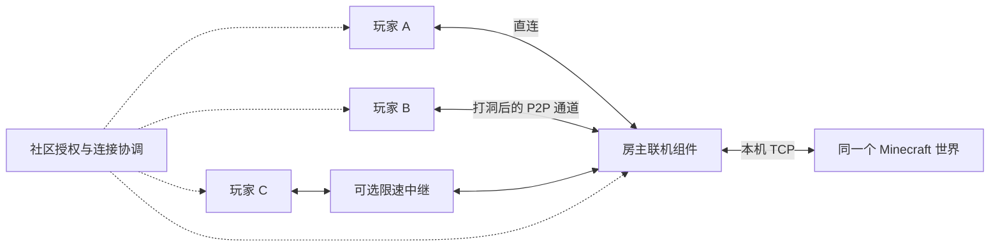

# P2P 联机可行性分析

2026-10-12；基于 E:/hxz_next 当前 0.7.0 源码。本文为方案分析，没有修改或发布联机功能，没有进行新的游戏或异地网络实测。由当前主任务独立完成。

## 结论与多人联机

可行。适合幻想镇的是「房主运行世界，多名玩家分别连接房主」的结构。每条连接可以独立选择公网直连、打洞直连或中继。玩家 A 直连、玩家 B 通过中继，也可以进入同一个世界。Minecraft 的世界状态仍由房主的内置服务器管理；不需要让每两个访客都互连，也不需要把游戏逻辑改成所有玩家共同计算。

推荐在现有 TCP/TLS 直连和社区中继之上补充 UDP 打洞与加密可靠通道。不能承诺所有网络都能纯 P2P。ICE 用于收集和验证候选连接；一些 NAT/防火墙组合仍需中继。[ICE 标准](https://www.rfc-editor.org/rfc/rfc8445)、[TURN 标准](https://www.rfc-editor.org/rfc/rfc8656.html)

多人规模受房主上传带宽、CPU、内存、世界生成和模组负载限制，不能仅凭 P2P 库给出人数保证。房主退出或休眠，世界服务随之不可用。手机加入电脑房主更适合作为第一阶段目标，手机托管大型模组世界另行验证。

## 当前代码已经具备什么

| 能力 | 源码事实 |
| --- | --- |
| 点对点传输 | `packages/engine/core/direct-lobby.mjs:45` 建立 TLS 监听，转发到房主本机世界端口；加入者在 `:114` 建立本机 TCP 入口。公网可达时，游戏字节已经直接传输。 |
| 公网寻找 | 同文件 `:69` 起收集本机公网地址、让社区探测，之后尝试 UPnP 的 TCP 端口映射。 |
| 虚拟局域网 | 同文件 `:70` 选择已有网卡；启动器没有自动创建覆盖网络，也没有安装虚拟网卡。 |
| 自动打洞 | 当前这条链路没有 STUN/ICE。`:15` 的 UDP socket 仅查询本机出站地址，没有发送打洞报文。 |
| 中继 | `packages/engine/core/room-relay.mjs` 通过 `/lobby-relay` WebSocket 建立双端通道；其中传输房间 TLS 数据。 |
| 中继限额 | `apps/community-server/src/room-relay.mjs:5` 默认 256；`:41` 按 `kbps × 1024` 实施每房间双向合计限速，不是每人 256 KB/s。后台范围为 64–4096 KB/s。 |
| 权限和房间 | `apps/community-server/src/direct-lobby.mjs` 提供授权、房间目录与十分钟租约；客户端每两分钟续验，到期关闭。 |
| 自动开放世界 | `packages/engine/core/direct-helper.mjs` 注入本地 Java 助手；`packages/engine/core/services.mjs:994` 当前入口限定 Java 版 1.20 及以后。 |
| 安卓大厅 | `mobile/web/src/LobbyPage.vue` 当前是查看、复制邀请和授权管理，没有连接 FCL 的 P2P 隧道启动流程。Android 能运行游戏不等于已具备桌面联机大厅的传输实现。 |

现有 `32` 上限统计的是 TCP 连接，包含可能的服务器列表探测等连接，不能直接解释为已验证支持 32 名玩家。实际人数还受房主世界设置限制。既有验证边界记录在 [MC直连大厅.md](./MC直连大厅.md)。

## 网络条件与服务器职责

| 情况 | 预期选择 |
| --- | --- |
| 同一局域网 | 本地直连。 |
| 双方具有相容的公网 IPv6，入站策略允许 | 可直接建立通道，无需 IPv4 端口映射。 |
| 房主公网 IPv4，端口自动映射成功 | 可沿用当前直连方式。 |
| 普通 NAT，双方允许 UDP | STUN/ICE 打洞有机会建立直连，需实际双端验证。 |
| CGNAT、多层 NAT、端点相关映射 | 不能仅凭网络标签判定；部分可打洞，部分需要中继。 |
| UDP 被封禁、地址族不相容且没有可行转换路径、严格入站限制 | 可能需要中继；不存在保证成功的纯 P2P 方案。 |

判断应以连接双方的候选地址检查为准。当前社区探测只代表社区到房主的路径，社区没有 IPv6 时可能漏掉玩家之间可用的 IPv6 路径。[Tailscale 对 NAT 穿透的技术说明](https://tailscale.com/blog/how-nat-traversal-works)

自动联机通常仍需要少量协调服务：社区处理登录、授权、房间目录和候选信息交换；STUN 帮助发现映射地址。它们不等于游戏中继，可以部署在现有主机，但 STUN 的 UDP 服务需要单独开放相应端口，普通 HTTPS 反向代理不会自动承担该职责。完全不使用协调服务，需要用户另行交换地址、密钥等信息，无法提供同样的自动发现体验。[ICE 候选交换与连通性检查](https://www.rfc-editor.org/rfc/rfc8445)

中继回退承载的是失败那条连接的完整游戏数据。不能通过只中转几个握手包保证之后全部直连。当前 256 KB/s 合计限制约为 2.1 Mbit/s，可能限制多人加载区块和大型模组登录；这是根据实现的容量判断，并非本次实测结果。[TURN 对中继的定义](https://www.rfc-editor.org/rfc/rfc8656.html)

## 推荐结构

在加入者侧保留 `127.0.0.1:动态端口`，游戏仍按原有 TCP 协议连接。联机组件把字节流送入加密可靠通道，房主组件再连接本机世界。只开放本次游戏端口，不必为了一个游戏引入全局 VPN 路由。

优先评估原生 WebRTC DataChannel：采用可靠、有序传输，正确处理分块、半关闭、背压和有界缓冲。不能直接把 Minecraft 字节放进无重传 UDP，也不能给游戏通道启用丢弃过期消息的部分可靠模式。DataChannel 标准提供 SCTP/DTLS/ICE 组合。[RFC 8831](https://www.rfc-editor.org/rfc/rfc8831.html)

`libdatachannel` 是候选实现：官方列出 Windows 和 Android 支持，可独立于界面生命周期运行。具体 Win7/ia32 工具链和依赖兼容性仍待验证，平台列表本身不证明支持 Win7。建议固定版本，复用现有房间验证，不自行发明加密协议。[libdatachannel 官方仓库](https://github.com/paullouisageneau/libdatachannel)

另一条路线是评估 EasyTier 的覆盖网络能力，其官方项目提供 NAT 穿透及中继。但对于当前单个 MC 端口，集成范围更广，需要额外处理网络权限、路由隔离和三端适配，因此作为备选，不在本次分析中宣称它性能更好或已兼容旧 Windows。[EasyTier 官方仓库](https://github.com/EasyTier/EasyTier)

## 适配时必须解决的问题

- **多人独立择路：** 每位访客维护独立连接状态和缓冲上限，某人掉线不能关闭其他人的通道；房间公平分配中继带宽。连接方式显示为每位玩家的实际结果。
- **低资源模式：** 桌面启动游戏后可以卸载 UI，但不能停止联机组件；传输不能依赖可被销毁的页面。安卓应接入原生运行组件及合规的可见前台服务生命周期，游戏结束及时释放。前台服务也不是不被系统终止的保证。[Android 前台服务文档](https://developer.android.com/develop/background-work/services/fgs)
- **连接时限：** 并行、有限度验证候选，不把多个超时串成漫长等待；失败显示“正在使用中继”或可执行的重试入口。不要向玩家显示“STUN 成功”就认为已经可以进世界。
- **授权独立于数据路径：** 保留管理员开房授权。为房间签发短期身份和密钥，皮肤站原始令牌不发送给房主或其他玩家。社区短暂重连与已建立的游戏通道分开处理，同时保留权限到期和撤销语义。
- **不伪装无缝切换：** 现有 `socket.pipe` 会在断线时销毁游戏连接。更换传输不能自然保留会话；先保证连接阶段正确选择通道。不断线迁移须另行实现和验证，不能把重新连接房间当作游戏会话恢复。
- **房主世界确实就绪：** 网络通道通了以后，仍需验证 LAN 开放助手成功、版本/加载器/整合包相容，再启动访客加入。P2P 不能代替游戏版本、登录和设备兼容检查。

## 建议落地顺序与验收界限

1. Windows x64 先完成同一房主、多访客的原生通道，复用已有授权、邀请、房间卡片及自动开放世界。
2. 增加 STUN/ICE 双端择路，保留 TCP/TLS 直连与现有中继作为兼容路径；明确显示每位玩家的直连/中继、延迟和流量。
3. Android 先实现加入电脑房主，再评估手机开房；ia32/Win7 单独编译验证，不以 x64 成功替代。

必要验证应覆盖家庭网络之间、宽带与移动热点、IPv4/IPv6 差异、UDP 受限、多个访客混合直连/中继，以及切页/启动器休眠仍保持连接。少量真实网络样本只能验证这些样本，不能宣传全国成功率；本次仅做源码与协议分析，没有执行上述联机验收。
